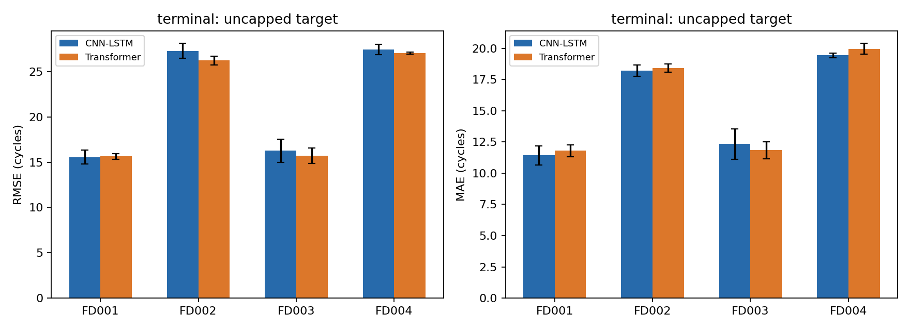
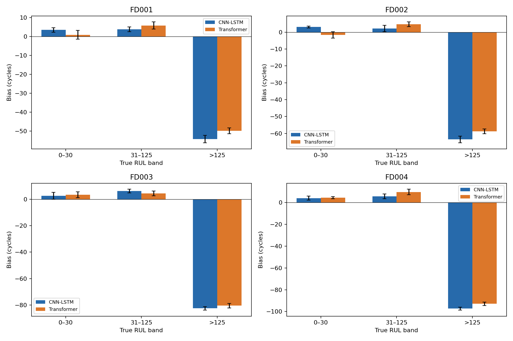
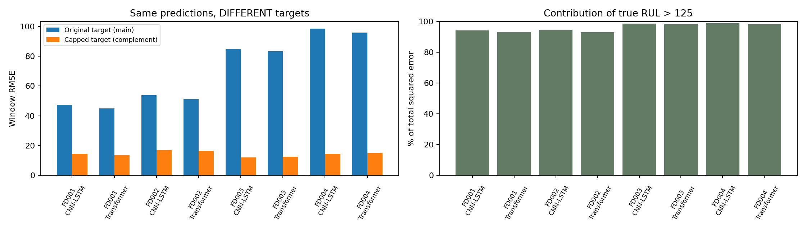
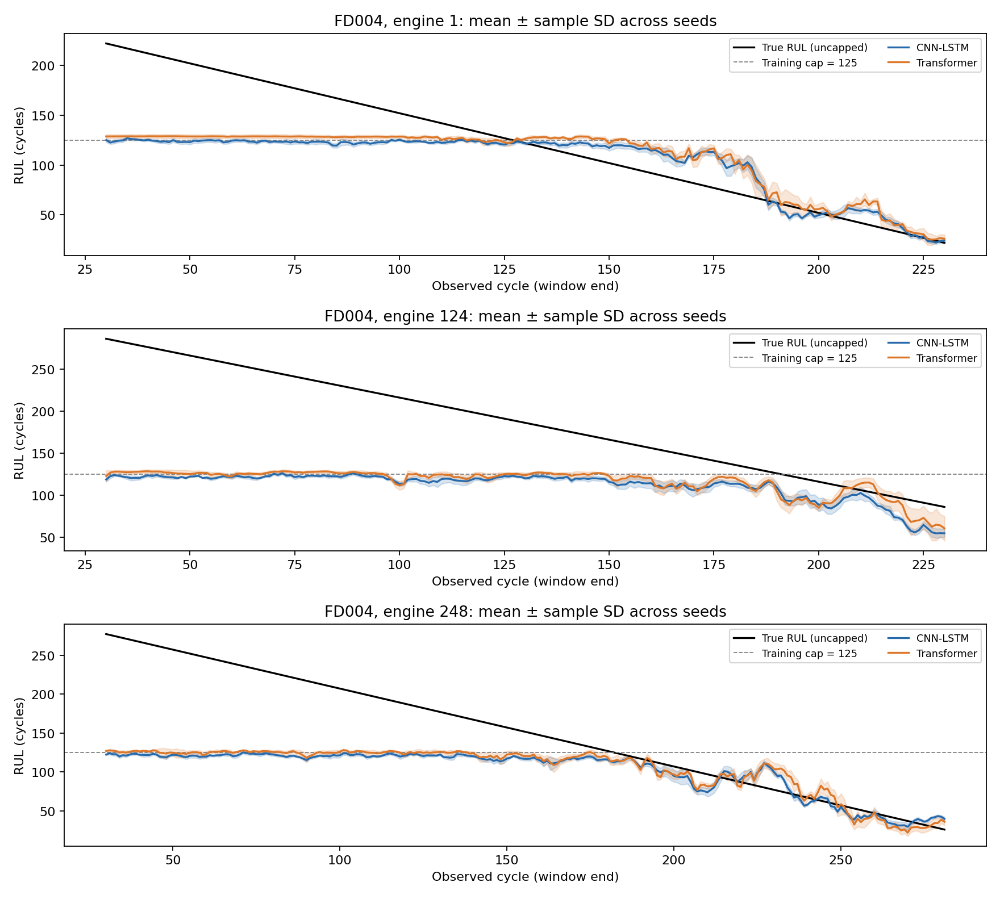

# RUL v2 — consolidação e análise dos resultados (Etapa A)

## 1. Objetivo, proveniência e protocolo

Este relatório consolida os experimentos `baseline` CNN-LSTM e Transformer em
FD001–FD004, com seeds 1–5. Utiliza exclusivamente previsões, métricas,
configurações e manifestos já persistidos. A avaliação **terminal por motor é
principal**; a avaliação por janela é complementar. Ambas usam RUL original,
sem cap. Não são comparações diretamente equivalentes às métricas históricas v1.

As tabelas foram recalculadas pelo módulo
[`analyze_results.py`](../src/rul_prediction/v2/analyze_results.py), não transcritas
dos valores de referência fornecidos pelo pesquisador. Esses valores de referência
coincidem com os resultados locais nas casas decimais informadas.

Foram validadas **80/80 avaliações**, sem resultados ausentes ou inconsistentes:
4 datasets × 2 arquiteturas × 5 seeds × 2 protocolos. Os hashes de manifestos,
configurações, previsões, figuras de avaliação, históricos e arquivos de modelos
foram conferidos. Os `.keras` foram somente lidos como bytes para calcular hashes:
nenhum modelo foi desserializado ou executado. Os resultados foram alinhados aos
metadados de teste do pré-processamento. Não foram abertos arrays NPZ, objetos
joblib ou bancos Optuna, nem a reserva de calibração.

Também foram conferidos identidade de dataset/modelo/seed, unicidade das chaves,
target `y_original_uncapped`, alvos originais/limitados, sequência temporal e
correspondência entre métricas e previsões. A tolerância absoluta dessa última
checagem é `1e-4` ciclo: a serialização de previsões float32 em CSV pode perder
algumas casas em relação ao cálculo registrado no JSON. Não se trata de uma
tolerância para mudar o protocolo científico.

Os insumos e seus hashes, a versão do script e as versões Python/NumPy/pandas
estão em [`summary.json`](../results/rul_prediction/v2/analysis/baseline_a_v1/summary.json).
O arquivo [`integrity.csv`](../results/rul_prediction/v2/analysis/baseline_a_v1/tables/integrity.csv)
registra o resultado de cada verificação. Os protocolos anteriores permanecem
documentados em [auditoria](rul_protocol_audit.md) e [protocolo v2](rul_protocol_v2.md).

## 2. Configuração dos datasets

| Dataset | Condições / modos de falha | Features v2 | Motores treino / validação / reserva | Motores teste | Janelas teste |
| --- | --- | ---: | --- | ---: | ---: |
| FD001 | 1 / 1 | 17 | 70 / 15 / 15 | 100 | 10.196 |
| FD002 | 6 / 1 | 24 | 182 / 39 / 39 | 259 | 26.511 |
| FD003 | 1 / 2 | 18 | 70 / 15 / 15 | 100 | 13.696 |
| FD004 | 6 / 2 | 24 | 174 / 38 / 37 | 248 | 34.092 |

As características de condições/modos seguem a descrição C-MAPSS registrada na
auditoria. As demais contagens provêm dos arquivos locais, não de uma suposição
sobre o número de motores. Features incluem settings e sensores selecionados.

A separação por motor usa seed 42, antes da seleção de features e normalização.
FD001/FD003 usam MinMax global; FD002/FD004 usam seis regimes e MinMax por regime,
ajustados somente nos motores de treino. As janelas têm 30 ciclos, passo 1,
com a política de padding original v2 preservada. A reserva não participou desta
análise ou da seleção dos preditores.

## 3. Arquiteturas e treinamento registrados

Ambas as arquiteturas recebem `(30, n_features)` e produzem RUL escalar linear.
A CNN-LSTM combina Conv1D, LSTM, Dropout e uma cabeça Dense; o Transformer usa
projeção linear, posição treinável, encoders com atenção/residuais/normalização,
pooling e cabeça Dense. Não foram alteradas nesta etapa.

As configurações salvas registram Adam, objetivo MSE de validação independente,
alvo de treinamento `min(RUL_original, 125)`, orçamento total de 30 trials,
sampler seed 42, até 50 épocas e patience 5. O treino final também usa até 50
épocas/patience 5, mantendo treino e validação separados e restaurando os
melhores pesos. Esses registros foram conferidos; o histórico do banco de trials
não foi reaberto para uma auditoria adicional das suas transições de estado.

| Dataset | Trial usado na CNN-LSTM | Trial usado no Transformer |
| --- | ---: | ---: |
| FD001 | 18 | 6 |
| FD002 | 16 | 4 |
| FD003 | 13 | 6 |
| FD004 | 27 | 9 |

Os hiperparâmetros completos e as identidades do pré-processamento estão em
[`protocols.csv`](../results/rul_prediction/v2/analysis/baseline_a_v1/tables/protocols.csv).
Nenhum trial ou seed foi escolhido com base nesta análise de teste.

## 4. Métricas e agregação

Para cada execução: `e = previsão − RUL_original`. MAE é a média de `|e|`;
RMSE é a raiz da média de `e²`; MedianAE, P95AE e MaxAE são mediana, percentil 95
(interpolação linear NumPy) e máximo de `|e|`. O viés é a média de `e`: negativo
indica subestimação, positivo indica superestimação. Não houve clipping das
previsões, inclusive no cálculo complementar com alvo limitado.

As tabelas principais mostram **média ± desvio padrão amostral entre cinco
seeds**, `ddof=1`. Primeiro calcula-se a métrica de cada execução; depois,
agregam-se as cinco métricas. Não se confunde essa média com a métrica de um
ensemble ou com RMSE de todas as seeds concatenadas. Todas as seeds são
preservadas em [`metrics_individual.csv`](../results/rul_prediction/v2/analysis/baseline_a_v1/tables/metrics_individual.csv).
Não se calcula uma média global de RMSE entre FDs.

## 5. Resultado principal: teste terminal

Valores em ciclos, média ± desvio entre seeds. Cada motor tem exatamente uma
previsão e o mesmo peso, em cada execução.

| Dataset | Modelo | RMSE | MAE | MedianAE | P95AE | MaxAE |
| --- | --- | --- | --- | --- | --- | --- |
| FD001 | CNN-LSTM | 15,5567 ± 0,7679 | 11,43 ± 0,77 | 8,12 ± 1,50 | 32,50 ± 0,91 | 47,85 ± 4,37 |
| FD001 | Transformer | 15,6513 ± 0,3032 | 11,80 ± 0,49 | 8,58 ± 0,94 | 32,22 ± 1,06 | 46,80 ± 1,25 |
| FD002 | CNN-LSTM | 27,3115 ± 0,8030 | 18,22 ± 0,46 | 9,63 ± 0,38 | 65,37 ± 1,52 | 101,27 ± 4,00 |
| FD002 | Transformer | 26,2424 ± 0,4769 | 18,43 ± 0,32 | 11,06 ± 0,11 | 63,14 ± 0,66 | 88,79 ± 4,95 |
| FD003 | CNN-LSTM | 16,2682 ± 1,2933 | 12,34 ± 1,23 | 8,98 ± 1,59 | 31,48 ± 2,31 | 55,15 ± 10,15 |
| FD003 | Transformer | 15,7073 ± 0,8546 | 11,85 ± 0,68 | 9,16 ± 1,34 | 32,39 ± 2,75 | 45,29 ± 4,44 |
| FD004 | CNN-LSTM | 27,4668 ± 0,5592 | 19,45 ± 0,20 | 11,79 ± 0,99 | 61,21 ± 2,65 | 96,73 ± 7,24 |
| FD004 | Transformer | 27,0616 ± 0,1091 | 19,97 ± 0,42 | 14,04 ± 0,91 | 58,02 ± 1,22 | 83,47 ± 9,12 |

Fonte: [`terminal_summary.csv`](../results/rul_prediction/v2/analysis/baseline_a_v1/tables/terminal_summary.csv).

Observações descritivas:

- FD001: a CNN-LSTM tem RMSE/MAE médios ligeiramente menores; a diferença de
  RMSE é apenas 0,095 ciclo, insuficiente por si só para alegar superioridade.
- FD002 e FD004: o Transformer tem menor RMSE, mas a CNN-LSTM tem menor MAE e
  mediana do erro. O menor P95AE/MaxAE do Transformer é compatível com redução
  de erros grandes, ao custo de erros típicos maiores. Isso não demonstra o
  mecanismo causal da diferença nem domínio de um modelo em todos os motores.
- FD003: o Transformer tem menor RMSE/MAE e menor máximo médio; a CNN-LSTM
  mantém mediana e P95AE menores. Mesmo nesse FD não há ordenação universal.
- Nenhuma comparação de médias foi tratada como teste de significância.



## 6. Resultado complementar: teste por janela

| Dataset | CNN-LSTM RMSE | Transformer RMSE | CNN-LSTM MAE | Transformer MAE |
| --- | --- | --- | --- | --- |
| FD001 | 47,36 ± 1,20 | 44,99 ± 0,86 | 33,49 ± 1,08 | 31,43 ± 0,68 |
| FD002 | 53,78 ± 1,16 | 51,28 ± 0,73 | 38,82 ± 1,03 | 36,89 ± 0,55 |
| FD003 | 84,68 ± 0,82 | 83,24 ± 1,05 | 56,32 ± 1,00 | 55,17 ± 1,09 |
| FD004 | 98,41 ± 0,78 | 95,72 ± 0,87 | 68,87 ± 0,76 | 66,72 ± 0,58 |

Fonte: [`windows_summary.csv`](../results/rul_prediction/v2/analysis/baseline_a_v1/tables/windows_summary.csv).

O Transformer apresenta menores RMSE/MAE médios por janela nos quatro FDs sob
alvo original. Esse resultado não substitui a avaliação terminal, em que os
modelos apresentam diferenças menores e rankings dependentes da métrica.

O conjunto de janelas contém fases anteriores e pesos diferentes por motor:

| Dataset | Janelas por motor: mínimo–máximo | RUL original máximo nas janelas | Janelas com RUL >125 | Motores terminais com RUL >125 |
| --- | --- | ---: | ---: | ---: |
| FD001 | 2–274 | 311 | 50,33% | 11,00% |
| FD002 | 1–338 | 348 | 50,16% | 22,01% |
| FD003 | 9–446 | 454 | 62,39% | 15,00% |
| FD004 | 1–457 | 524 | 65,73% | 27,02% |

Essas distribuições diferem substancialmente das terminais. Para quantificar
também a ponderação, foi calculado um complemento com peso igual por motor:
`RMSE_balanceado = sqrt(média_motores(MSE_motor))`. Não é a média dos RMSEs
dos motores, nem a métrica terminal.

| Dataset | RMSE por janela CNN-LSTM: usual → balanceado | Transformer: usual → balanceado |
| --- | --- | --- |
| FD001 | 47,36 → 40,77 | 44,99 → 38,57 |
| FD002 | 53,78 → 50,10 | 51,28 → 47,49 |
| FD003 | 84,68 → 63,02 | 83,24 → 61,83 |
| FD004 | 98,41 → 76,36 | 95,72 → 74,08 |

Nesta amostra, o peso adicional dos motores com mais janelas aumenta o agregado
usual, especialmente em FD003/FD004. Mesmo com peso igual por motor, permanece
uma diferença expressiva em relação ao terminal: a ponderação não explica tudo.
As análises de ponderação e de faixa de RUL se sobrepõem; seus efeitos não devem
ser somados como contribuições causais independentes.

## 7. Erros por faixa de RUL original

Faixas fixadas: A = 0–30, B = 31–125 e C >125. A tabela usa somente `windows`.
Cada célula de MAE é a média das cinco execuções; os desvios, RMSE, mediana,
P95AE e contagens por execução estão em
[`bands_individual.csv`](../results/rul_prediction/v2/analysis/baseline_a_v1/tables/bands_individual.csv)
e [`bands_summary.csv`](../results/rul_prediction/v2/analysis/baseline_a_v1/tables/bands_summary.csv).

| Dataset | Modelo | MAE A | MAE B | MAE C | Viés C |
| --- | --- | ---: | ---: | ---: | ---: |
| FD001 | CNN-LSTM | 4,89 | 13,03 | 54,20 | −54,20 |
| FD001 | Transformer | 4,46 | 13,33 | 49,86 | −49,86 |
| FD002 | CNN-LSTM | 5,88 | 14,67 | 63,54 | −63,54 |
| FD002 | Transformer | 7,69 | 15,53 | 58,76 | −58,76 |
| FD003 | CNN-LSTM | 5,44 | 13,21 | 82,57 | −82,57 |
| FD003 | Transformer | 5,58 | 13,51 | 80,56 | −80,55 |
| FD004 | CNN-LSTM | 6,61 | 14,93 | 97,31 | −97,31 |
| FD004 | Transformer | 7,84 | 17,20 | 92,90 | −92,89 |

| Dataset | A: janelas / motores | B: janelas / motores | C: janelas / motores |
| --- | --- | --- | --- |
| FD001 | 332 / 25 | 4.732 / 89 | 5.132 / 89 |
| FD002 | 1.087 / 61 | 12.127 / 202 | 13.297 / 234 |
| FD003 | 291 / 20 | 4.860 / 85 | 8.545 / 95 |
| FD004 | 864 / 53 | 10.820 / 181 | 22.408 / 231 |

As contagens são **por execução**, não multiplicadas por cinco. Um motor pode
aparecer em várias faixas, portanto não se somam os motores das três colunas
para obter o número de motores únicos.

Há subestimação consistente na faixa C em todos os FDs e arquiteturas. Nessa
faixa, o Transformer apresenta menor MAE médio, mas a CNN-LSTM apresenta menor
MAE na faixa B nos quatro FDs e na faixa A em FD002/FD003/FD004. Portanto, a
vantagem global por janela do Transformer não se repete em todas as fases.

Os MAEs próximos da falha são menores em termos absolutos (4,46–7,84 ciclos),
mas não existe um limiar de aceitabilidade operacional validado aqui. Além
disso, os motores de teste são truncados: o menor RUL observado é 7 em FD001
e 6 nos demais. A faixa A **não contém falhas efetivamente observadas nem RUL
0–5** nesta avaliação. As janelas de A também são dependentes dentro de cada
motor. Não generalizar esse resultado como detecção perfeita de falha iminente.



## 8. Efeito do cap 125: quantificação e limites da interpretação

Para cada seed, a soma dos erros quadráticos (SSE) pode ser separada exatamente
pelas faixas. A participação da faixa C é `SSE_C / SSE_total`, não a proporção
de RMSE. Os percentuais abaixo são médias dessas participações entre seeds.

| Dataset | SSE em RUL >125: CNN-LSTM | Transformer | RMSE contra alvo limitado: CNN-LSTM | Transformer |
| --- | ---: | ---: | --- | --- |
| FD001 | 94,09% | 93,22% | 14,53 ± 0,82 | 13,66 ± 0,19 |
| FD002 | 94,35% | 92,97% | 16,79 ± 0,92 | 16,37 ± 0,32 |
| FD003 | 98,47% | 98,36% | 12,18 ± 0,88 | 12,48 ± 0,58 |
| FD004 | 98,74% | 98,32% | 14,46 ± 0,41 | 15,01 ± 0,67 |

Fonte: [`cap_contribution_summary.csv`](../results/rul_prediction/v2/analysis/baseline_a_v1/tables/cap_contribution_summary.csv)
e [`cap_complement_summary.csv`](../results/rul_prediction/v2/analysis/baseline_a_v1/tables/cap_complement_summary.csv).
O último par de colunas é um protocolo **complementar, com target diferente**:
troca-se apenas o alvo por `min(RUL_original,125)`, mantendo as previsões salvas
sem qualquer clipping. Há resultados complementares terminais nos mesmos CSVs.
As métricas oficiais não foram alteradas.

Em FD004, por exemplo, o RMSE por janela da CNN-LSTM passa de 98,41 contra o
alvo original para 14,46 contra o limitado; no Transformer, de 95,72 para 15,01.
Esses números não são uma melhoria do modelo: os pesos e previsões são idênticos
e a tarefa de avaliação mudou. Também não são comparações diretas com modelos
v1, que foram treinados/normalizados e validados sob outro protocolo.

Uma decomposição do viés explicita a mudança de alvo. Definindo
`d = max(RUL_original − 125, 0)`:

`erro_original = erro_contra_cap − d`.

Em FD004, a média de `d` nas janelas é 59,98 ciclos. O viés CNN-LSTM contra o
alvo limitado é −2,10; contra o original, −62,08. No Transformer, +2,07 torna-se
−57,90. Trata-se de uma identidade aritmética, não de uma estimativa causal do
efeito que outro treinamento teria.

Os dados sustentam três observações: grande exposição a RUL alto, subestimação
nessa região e forte concentração da SSE nela. São coerentes com o treinamento
que colapsa todos os alvos acima de 125 no mesmo valor. A saída linear **não é
limitada matematicamente a 125**, e há erros de aproximação mesmo contra o alvo
limitado. Não se demonstrou que treinar sem cap eliminaria a diferença, nem que
o cap seja sua única causa. RUL alto também não equivale automaticamente a uma
condição física "saudável" identificada por sensores.

Avaliar contra RUL original informa o erro de vida remanescente em sua escala
completa; avaliar contra cap mede aderência à representação supervisionada usada
no treino e deliberadamente deixa de distinguir vidas acima de 125. Ambas são
informativas, mas respondem a perguntas distintas. Não usar a mudança de ranking
no complemento (CNN-LSTM com menor RMSE em FD003/FD004) para redefinir o campeão
ou ajustar o protocolo a posteriori.



## 9. Análise temporal e estabilidade entre seeds

### 9.1. Motores escolhidos sem consultar erros

Regra determinística: IDs ordenados, selecionar primeiro, central inferior e
último. Não usa previsões, duração ou desempenho. É uma ilustração com cobertura
do espaço de IDs, **não uma amostra estatisticamente representativa de modos
de falha ou comprimentos de trajetória**.

| Dataset | Motores selecionados |
| --- | --- |
| FD001 | 1, 50, 100 |
| FD002 | 1, 130, 259 |
| FD003 | 1, 50, 100 |
| FD004 | 1, 124, 248 |

Os gráficos preservam motor/ciclo e mostram RUL original, previsão média das
cinco seeds e faixa de ±1 desvio amostral. A média é uma estatística descritiva,
não um ensemble avaliado como baseline. O sombreado não é intervalo de confiança
ou incerteza calibrada, e o teste termina antes da falha real.

Em FD004, os três exemplos mostram previsões iniciais próximas da região de
125 enquanto o alvo original está bem acima dela. Na transição para RUL menor,
as previsões passam a acompanhar mais a trajetória, mas com oscilações e erros:
no motor 124 há subestimação também na parte observada abaixo do cap; no motor
248 há alternância de erros ao longo da descida. A inspeção não sugere tracking
perfeito nem monotonicidade garantida, e não é usada para escolher os exemplos.



Outros exemplos: [FD001](../results/rul_prediction/v2/analysis/baseline_a_v1/figures/trajectories_fd001.png),
[FD002](../results/rul_prediction/v2/analysis/baseline_a_v1/figures/trajectories_fd002.png),
[FD003](../results/rul_prediction/v2/analysis/baseline_a_v1/figures/trajectories_fd003.png).
Os dados que geraram as curvas estão em
[`trajectory_predictions.csv`](../results/rul_prediction/v2/analysis/baseline_a_v1/tables/trajectory_predictions.csv).

### 9.2. Três variabilidades diferentes

1. **Métricas entre inicializações:** desvios das cinco métricas agregadas.
   O desvio do RMSE terminal é menor no Transformer nos quatro FDs: por exemplo,
   0,109 em FD004 contra 0,559 na CNN-LSTM. As cinco execuções ainda são poucas
   para caracterizar completamente a sensibilidade ao treinamento.
2. **Erros entre motores:** distribuição do MAE de cada motor, após média entre
   seeds, em [`per_engine_summary.csv`](../results/rul_prediction/v2/analysis/baseline_a_v1/tables/per_engine_summary.csv)
   e no [boxplot entre motores](../results/rul_prediction/v2/analysis/baseline_a_v1/figures/engine_error_distribution.png).
   Não é um boxplot de seeds; um motor longo não vira várias unidades nesse gráfico.
3. **Previsão de uma mesma janela entre seeds:** desvio entre as cinco previsões
   alinhadas ao mesmo motor/ciclo. A média desses desvios nas janelas é:

| Dataset | CNN-LSTM: SD da previsão | Transformer: SD da previsão |
| --- | ---: | ---: |
| FD001 | 3,41 | 2,70 |
| FD002 | 2,90 | 3,81 |
| FD003 | 3,07 | 2,86 |
| FD004 | 3,02 | 4,25 |

Portanto, menor variação de RMSE agregado **não implica** previsões mais estáveis
em cada janela: em FD002/FD004, o Transformer tem maior dispersão local média.
Erros diferentes entre motores podem se compensar na métrica global. Essa é
uma interpretação compatível com os agregados, não um mecanismo demonstrado.
Fonte: [`prediction_dispersion_summary.csv`](../results/rul_prediction/v2/analysis/baseline_a_v1/tables/prediction_dispersion_summary.csv).

Os [gráficos das métricas individuais](../results/rul_prediction/v2/analysis/baseline_a_v1/figures/seed_stability.png)
preservam todas as seeds. Não houve descarte de execuções ou escolha da melhor
seed. Os desvios não estimam incerteza por reamostragem de motores, de divisões
treino/validação ou de uma nova busca de hiperparâmetros.

## 10. Discussão comparativa dos quatro FDs

FD002/FD004 apresentam RMSE terminal maior que FD001/FD003 nas duas arquiteturas.
Isso é compatível com uma tarefa diferente e potencialmente mais heterogênea,
mas não isola o efeito das seis condições operacionais. As populações, alvos,
trajetórias e conjuntos selecionados para ajuste também diferem. Não há uma
ablação controlada que atribua causalidade a regimes ou a modos de falha.

Um cuidado adicional: FD003 tem RMSE terminal próximo de FD001, mas RMSE por
janela muito maior. As janelas de FD003 incluem RUL até 454 e 62,39% acima de
125, contra 311 e 50,33% em FD001. Comparar apenas o RMSE por janela como um
índice uniforme de "dificuldade de FD003" desconsideraria a escala dos alvos.
FD004 amplia esse padrão, com RUL até 524 e maior participação de trajetórias
longas. Contra alvo limitado, o RMSE por janela não segue essa mesma ordem.

O resultado terminal também é sensível a RUL alto: a faixa C representa 11–27%
dos motores e concentra, por exemplo, 78,51%/73,82% da SSE terminal em FD002
(CNN-LSTM/Transformer). Esses percentuais não são os mesmos da avaliação por
janela. A heterogeneidade dos targets ajuda a contextualizar as comparações,
sem apagar erros dentro das faixas A/B.

## 11. Limitações metodológicas

- A análise é descritiva. Não há teste de significância, intervalo por bootstrap
  de motores ou alegação de superioridade populacional.
- São cinco seeds por arquitetura e uma divisão fixa de desenvolvimento. A
  variabilidade de partição e da seleção por Optuna não está estimada.
- O alvo limitado no treinamento e original na avaliação são escolhas distintas,
  agora quantificadas, não defeitos automaticamente provados de implementação.
- Janelas sobrepostas do mesmo motor são dependentes; não são novas observações
  independentes para um teste estatístico. Na métrica usual, motores longos pesam mais.
- Modos de falha não foram inferidos ou usados para estratificar estas análises.
  O catálogo de condições/modos não prova qual mecanismo gerou um erro individual.
- A região próxima da falha contém somente parte dos motores e não alcança
  efetivamente RUL zero no teste truncado.
- Padding e transições de regime foram preservados; não houve uma ablação
  específica para quantificar separadamente seus efeitos.
- A integridade dos artefatos não demonstra correção física dos sinais, ausência
  de toda forma de viés humano ou desempenho em motores reais fora do C-MAPSS.
- O teste oficial já foi consultado em etapas anteriores. Novas decisões de
  desenvolvimento não devem ser otimizadas reiteradamente por esses resultados.
- As previsões são lineares e não necessariamente monótonas, positivas ou
  limitadas a 125. Nenhuma restrição adicional foi aplicada nesta etapa.

## 12. Implicações para a futura integração com Autoencoder

As baselines RUL v2 devem permanecer congeladas. O próximo passo é **desenhar
e auditar a compatibilidade dos grupos e das janelas do AE**, antes de associar
scores existentes ou implementar uma fusão. Não se demonstrou melhoria por AE.

Hipóteses futuras a testar apenas em desenvolvimento:

- Um score de reconstrução pode complementar informação de degradação nas
  faixas A/B, onde há targets distintos no treinamento, e antecipar alterações
  não capturadas pelo preditor. Isso requer evidência: score alto também pode
  refletir regime, escala ou distribuição diferente, não apenas degradação.
- Na faixa C, erro contra RUL original não prova ausência de informação de
  anomalia. Tampouco o AE pode, por si só, resolver a perda de distinção dos
  alvos de treinamento acima de 125; a hipótese e a tarefa devem ser declaradas.
- Avaliar baseline versus versão integrada nas mesmas coortes/seeds e com o
  mesmo target principal, relatando RMSE/MAE terminal e faixas de RUL. Planejar
  diferenças por motor e incerteza por reamostragem de motores, sem tratar
  janelas sobrepostas como independentes.

Os grupos do AE atual têm protocolo próprio. Nenhum motor da validação do
preditor deve entrar no ajuste do AE/transformadores que alimentarão a seleção
integrada. A necessidade de scores fora da amostra no desenvolvimento e eventual
cross-fitting deve ser examinada, não presumida automaticamente.

A associação futura deve usar `Dataset, SourceSplit, unit_nr, start_cycle,
end_cycle`, preservando `Split`. Não concatenar por índice. Cada ramo mantém
seu próprio normalizador; janelas curtas sem equivalente no AE exigem política
explícita, não score zero. A reserva de calibração não foi consumida nem recebeu
papel definitivo aqui. Escolhas de fusão/thresholds devem preceder o teste final.

## 13. Conclusões, inventário e reprodução

Cinco conclusões principais:

1. As 80 avaliações são consistentes com os manifestos e previsões, constituindo
   baselines v2 rastreáveis, sem refazer experimentos.
2. O Transformer tem menor RMSE terminal médio em três FDs, mas a CNN-LSTM
   tem menor MAE em três FDs. Não há vencedor universal nem superioridade estatística demonstrada.
3. A faixa RUL >125 concentra 92,97–98,74% da SSE por janela. Mudar somente o
   target para o limitado reduz fortemente essas métricas, sem melhorar a rede.
4. Os erros absolutos próximos da falha são menores que nas outras faixas,
   com limitações de cobertura e dependência temporal. Ganho global de um modelo
   não garante ganho nessa faixa.
5. Estabilidade de uma métrica agregada não equivale a estabilidade de cada
   previsão; o próximo passo com AE precisa preservar essa distinção e as
   divisões independentes, não selecionar novamente pelos resultados de teste.

Artefatos novos em
[`analysis/baseline_a_v1/`](../results/rul_prediction/v2/analysis/baseline_a_v1/):

- **17 CSVs:** métricas individuais e resumos terminal/janelas; faixas individuais
  e resumidas; contribuição do RUL alto e protocolo com target limitado; erros
  por motor; dispersão de previsões; trajetórias selecionadas; coortes,
  configurações e integridade. Os nomes completos estão em `summary.json`.
- **12 figuras:** métricas terminais/janelas; RMSE/viés por faixa; efeito do cap;
  métricas das seeds; erros entre motores; dispersão local entre seeds; quatro
  gráficos de trajetórias, um por FD.
- **summary.json:** cobertura, limitações, insumos e hashes, tolerância, política
  de seleção e identificação do código de análise.

Testes desta etapa: **10 aprovados**, com fixtures sintéticas e modelos fictícios
tratados apenas como arquivos. Verificam leitura/identidade, fórmulas, viés,
fronteiras das faixas, contagens, agregação amostral, duplicatas, alinhamento
temporal, integridade, registros ausentes e não sobrescrita. A análise real foi
executada com imports de TensorFlow, Keras e Optuna explicitamente bloqueados.
Os gráficos de efeito do cap e de trajetórias FD004 também foram inspecionados.

```powershell
python -B -m unittest tests.rul_prediction.test_v2_analysis -v
python -m src.rul_prediction.v2.analyze_results --help

# Repetir a análise completa com um NOVO nome:
python -m src.rul_prediction.v2.analyze_results --datasets FD001 FD002 FD003 FD004 --seeds 1 2 3 4 5 --experiment baseline --name baseline_a_v2
```

O nome padrão é `baseline_a_v1`, já utilizado. A execução recusa qualquer pasta
de análise existente, inclusive parcial; não há `--overwrite`. Para outra
repetição, escolha outro nome novo. Nomes, tabelas e seleção de motores são
determinísticos para os mesmos insumos. Resultados ausentes/inconsistentes são
registrados em `integrity.csv`/`summary.json` e excluídos dos cálculos, sem
inventar valores; os resumos informam o número efetivo de seeds.

**Confirmação do escopo:** nenhuma rede treinada, nenhum estudo Optuna executado,
nenhuma previsão nova por inferência, nenhum resultado/modelo/estudo histórico
sobrescrito e nenhum dado C-MAPSS reprocessado. Nenhum script de treinamento,
avaliação ou pré-processamento foi modificado. O relatório termina nesta etapa,
sem implementar integração, anomalias ou XAI.
